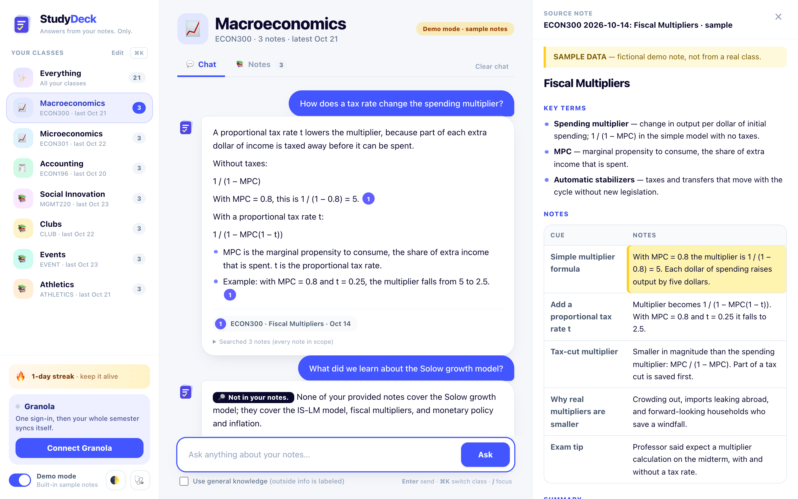
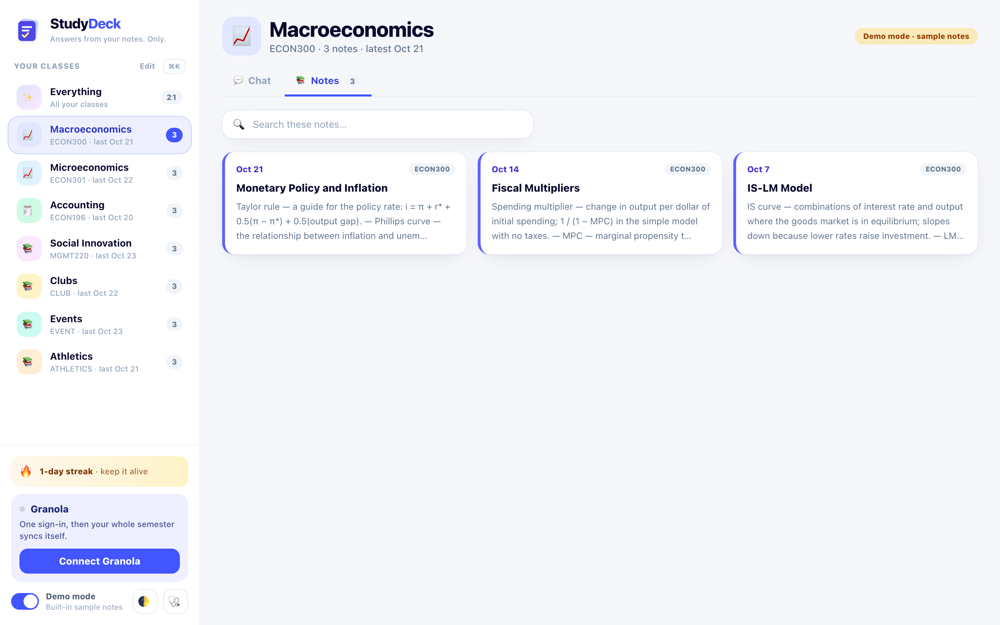
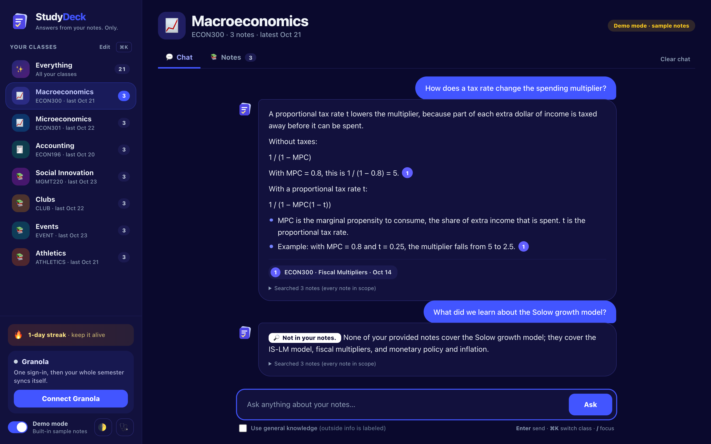
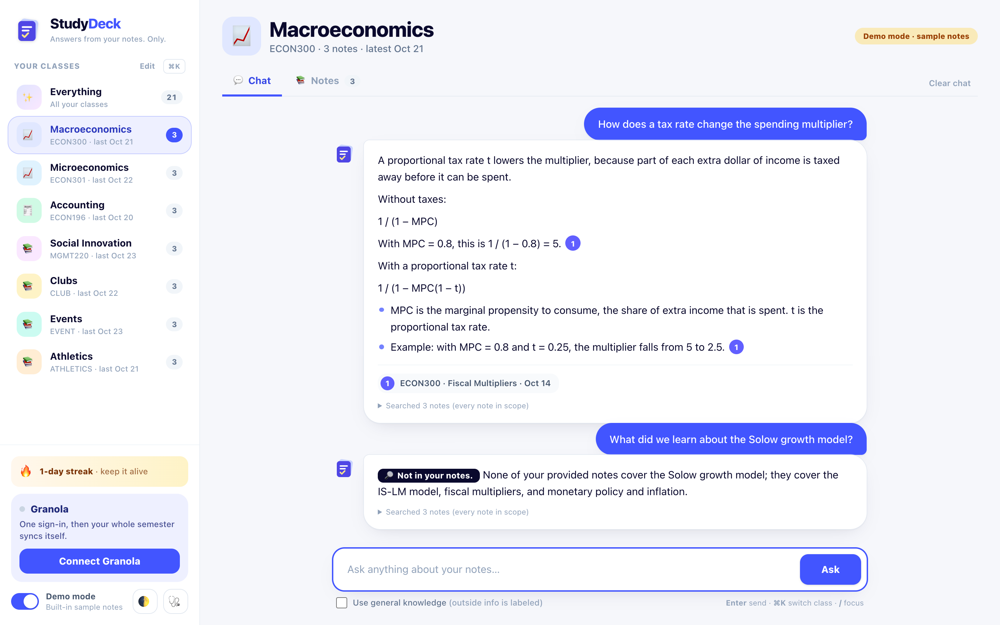
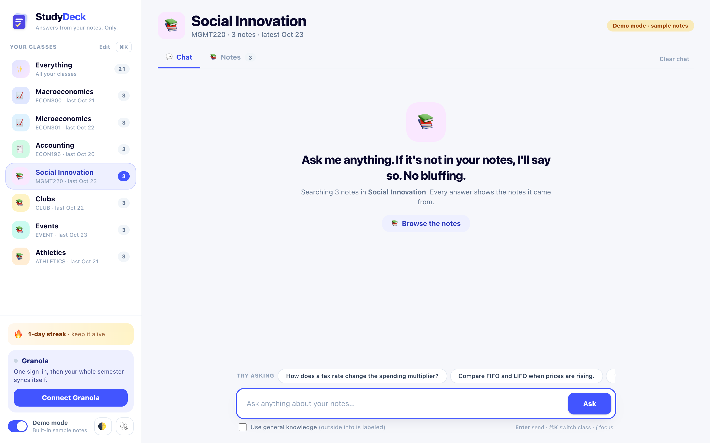
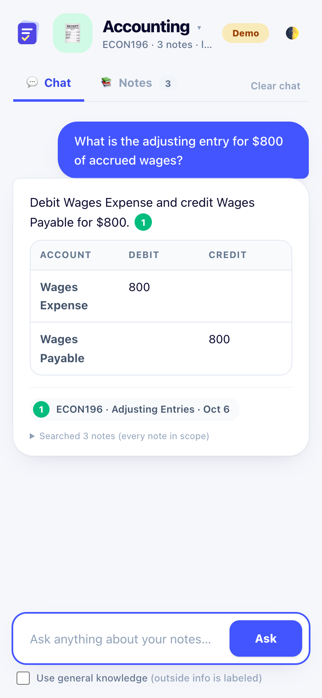
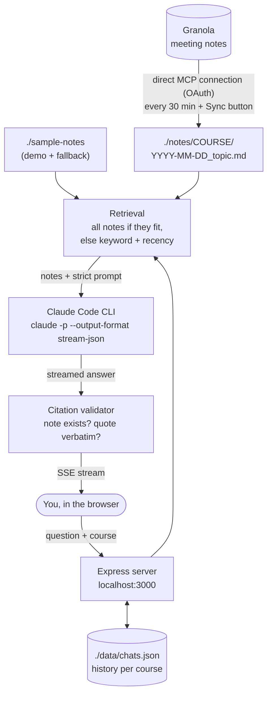

<p align="center">
  
</p>

<h1 align="center">StudyDeck</h1>

<p align="center"><b>A NotebookLM for your own semester: ask questions about your class notes and get answers that only come from your notes, with a receipt for every claim.</b></p>

<p align="center">
  
</p>

<p align="center"><i>Every claim links to the note it came from. Click a citation and the source opens, scrolled to the exact passage.</i></p>

---

## Why I built it

I'm a junior at Hobart and William Smith studying Economics with an Entrepreneurship minor. This semester my notes are spread across four classes (Macro, Micro, Accounting, Social Innovation) plus clubs, events and athletics. I take them all in [Granola](https://granola.ai), which is great for capturing a lecture and bad at answering "wait, what did the professor say about the tax-cut multiplier?" three weeks later.

I tried AI study tools, and two things kept bugging me:

1. **Uploading.** Every tool wanted me to export, upload and organize files. My notes already exist; I wanted a tool that already knows my semester.
2. **Confident guessing.** When my notes didn't cover something, chatbots filled the gap with general knowledge that sounded like my professor but wasn't. Before an exam, I need to know what *was* covered.

StudyDeck fixes both. It copies my Granola notes straight into class folders (using the folders I already made in Granola), keeps them up to date by itself, and answers **only** from those notes. Every claim carries a citation, and **"Not in your notes"** is a perfectly good answer.

## Features

- 📚 **Class-aware chat.** Pick a class (or Everything) in the sidebar and the chat only reads that class's notes.
- 🧾 **Cited, verified answers.** Each claim carries a numbered citation. The server checks that every cited note was actually provided and that the quote appears word-for-word; anything that fails turns into a red `!`.
- ✂️ **Short answers.** The answer comes first, in a few lines, with a sources row underneath. It doesn't retell your whole note.
- 🔎 **"Not in your notes" is first-class.** The model is told not to fill gaps. Outside knowledge is opt-in with a clearly labeled toggle, and every outside sentence is tagged 🌐 General knowledge.
- 👀 **Hover or click any citation.** Hover for the exact passage; click to open the note scrolled to it and highlighted.
- 🔗 **Direct Granola connection.** Sign in to Granola once. StudyDeck then copies your whole semester of notes exactly as Granola has them (no AI in the middle), files them by your Granola folders, picks up notes you edit later, and re-syncs in the background every 30 minutes.
- 📚 **Notes browser.** Every class has a Notes tab: cards by date with previews and search.
- 📥 **Inbox.** Notes that aren't in a Granola folder land in the Inbox, where you file each under a class with one click.
- 🎬 **Demo mode** with 21 built-in sample notes, so a demo never depends on live sync or your private notes.
- ⌨️ **Keyboard first:** `Enter` to send, `⌘K` to switch class, `/` to focus, `Esc` to close.
- 🌙 **Dark mode**, 📱 **phone layout**, and a 🔥 **study streak** to keep you coming back.
- 🧠 **Study tab.** FSRS spaced-repetition flashcards (the same family of scheduler Anki uses) with a daily limit, a flip-and-rate player with the next interval shown on each button, keyboard shortcuts, a 7-day forecast, accuracy, and a streak that counts studying. Cards can be made by hand or generated from your lectures (see below).
- ✨ **Cards from your lectures, with receipts.** Pick lectures (or a whole class), choose how many cards per lecture, see the Claude-call estimate, and generate. Every card carries a quote copied word for word from your note. Before a card is saved, my code checks that the quote really is in the note, that any numbers on the card come from the note, that it asks one thing (not two), and that it isn't a duplicate. Cards that fail are dropped, and you can see exactly which and why. A lecture is only processed again if you edit it in Granola, and existing cards and their review history are never touched.
- ⏸ **AI usage meter and Pause AI.** The sidebar shows how many times Claude has been asked today. One switch turns every AI feature off; reviewing cards never uses AI.
- 🩺 **Doctor.** One screen (or `npm run doctor`) checks your setup and says how to fix anything.
- 🔒 **Local and private.** Notes are markdown files on your machine. No database server, no API keys, no cloud storage.

| Notes browser | Dark mode |
|---|---|
|  |  |

| "Not in your notes" (honesty by default) | Empty state with "Try asking" |
|---|---|
|  |  |

<p align="center"></p>

## How it works



1. **Sync.** StudyDeck signs in to Granola's MCP server itself (OAuth with PKCE; the login is stored in `./data`, readable only by you). It lists your last 120 days of meetings, reads them in batches of ten, and writes each as markdown into `./notes/<class>/`. The class comes from the meeting's Granola folder, then a class code or keyword in the title, else the Inbox. Notes are matched by Granola id, so re-running never duplicates, and notes you edit in Granola are refreshed. No AI is involved, so it's fast, exact, and uses none of your Claude plan.
2. **Retrieve.** If a course's notes fit comfortably in context (about 200k characters) they're all sent. Otherwise notes are ranked by keyword overlap plus a recency boost. The UI always says which notes were read.
3. **Answer.** The server spawns `claude -p` in a locked-down mode: no tools, no MCP servers, no user settings or `CLAUDE.md`, no saved session. That keeps each call to about 2.5k tokens of overhead instead of about 60k. Notes are wrapped in `<note>` tags and marked as data, not instructions.
4. **Verify.** Every citation is parsed and checked against the notes that were sent. The answer streams to the browser over Server-Sent Events.

**Stack:** Node + TypeScript + Express on the server; plain HTML/JS + Tailwind CSS v4 in the browser; Vitest for tests. No framework, no database, no API key.

## StudyDeck vs. NotebookLM

NotebookLM is a great product, and it also cites its sources. StudyDeck is narrower on purpose: it's built for one student's semester.

| | StudyDeck | NotebookLM |
|---|---|---|
| Getting notes in | **Auto-syncs from Granola**, routed by course | Upload or link sources per notebook |
| Knows your semester structure | **Yes**: courses, clubs, events, with a scope switch | You organize notebooks yourself |
| Answers grounded in your sources with citations | Yes | Yes |
| Each citation re-checked word-for-word after answering | **Yes**, failures flagged with ⚠ | Citations link to source passages |
| "Not in your notes" as an explicit answer | **Yes, a labeled badge, by default** | Usually says the sources don't cover it |
| Outside knowledge | **Off by default**; opt-in and labeled sentence by sentence | Mostly limited to sources |
| Where your notes live | **Plain files on your laptop** | Google's cloud |
| Flashcards, quizzes, study guides | Roadmap (Exam mode) | **Yes** |
| Audio overviews, PDFs, YouTube, slides as sources | No | **Yes** |
| Setup | Node + Claude Code CLI | **None, just a browser** |

## Quick start

You need **Node 24+** and **[Claude Code](https://claude.com/claude-code)** installed and logged in (run `claude` once). No API key is required; StudyDeck uses your existing Claude login.

```bash
# 1. Get the code
git clone https://github.com/seankessner05/studydeck-pro.git && cd studydeck-pro

# 2. Install
npm install

# 3. Run, then open http://localhost:3000
npm start

# 4. In the app, click "Connect Granola" in the sidebar and sign in once.
#    Your whole semester syncs, then keeps itself fresh.
```

Until you connect, StudyDeck uses the 21 sample notes in `./sample-notes`. Flip **Demo mode** in the sidebar to use the samples even after you have real notes.

**Match your Granola folders to your classes.** A class picks up notes from the Granola folder with the same name (a folder called "Macroeconomics" feeds the class named Macroeconomics). Add your own classes with **Edit** in the sidebar.

Prefer the terminal? `npm run sync` does the same sync (and falls back to a slower Claude-based sync of the last 14 days if Granola isn't connected yet).

**Scripts:** `npm start` (build CSS + run), `npm run dev` (auto-reload), `npm run sync`, `npm run doctor` (checks your setup and says how to fix anything), `npm run eval` (19 regression questions against the sample notes), `npm run eval:cards` (generates cards for six sample lectures and reports how many pass the checks), `npm test`, `npm run typecheck`. Set `PORT` to change the port.

### Note format

Notes are markdown with a small frontmatter header. Synced notes look like this:

```markdown
---
title: Fiscal Multipliers
course: ECON300
date: 2026-10-14
source: granola
granola_id: abc123
---
...your notes...
```

Notes that aren't in a mapped Granola folder land in the Inbox (`./notes/unsorted`), where you can file them under a class. Naming a meeting with a class code (`ECON300 Fiscal policy`) also routes it automatically.

## Privacy

- `./notes` (your real notes), `./data` (chat history, settings, and your Granola login) and `.env*` are git-ignored. Only the fictional sample notes are in this repo. The Granola login file is created readable by you only.
- Notes are sent to Claude through your own Claude Code login, the same as if you pasted them into Claude yourself. Nothing else leaves your machine.
- The server listens on `127.0.0.1` only.

## Roadmap

The goal: a Quizlet-meets-NotebookLM study partner that knows your whole semester. Flashcards with spaced repetition are in; the rest is in progress.

- 🧩 **Quizzes, practice problems and exams** built on the same checked-receipt idea.
- 📖 **Source library.** Add or remove anything at any time: textbook chapters (PDF or pasted), syllabi, past exams, slides, YouTube transcripts, web pages. Everything becomes searchable and cited with page numbers or timestamps.
- 🧭 **Where am I.** Combine the syllabus, your Canvas calendar and your lecture notes into a per-class "this week, covered so far, due next" view, plus a gap check for topics you may have missed.
- 🃏 **Study mode, next steps.** Generate cards from lectures with verified quote receipts, then quizzes and original practice problems in your professor's style, each solved and re-checked independently before you see it. (Spaced-repetition flashcards already work.)
- 🎯 **Weak-spot tracking** and an **exam mode**: a one-page cheat sheet and a mock exam scoped to what's been covered.
- 🧠 **Semantic search** (local) for very large semesters.

## Limitations (honestly)

- **Needs Claude Code.** Every question runs the `claude` CLI on your machine and counts against your Claude plan. Answers take about 3 to 15 seconds. (Syncing Granola does not use Claude.)
- **Granola summaries, not transcripts.** Sync copies Granola's AI-enhanced notes plus anything you typed yourself. Full transcripts aren't synced yet.
- **The direct Granola connection is new.** If it ever misbehaves, `npm run sync -- --via-claude` is the slower fallback.
- **Keyword retrieval.** When a class outgrows the context budget, ranking is keyword + recency, not semantic, so a question phrased very differently from the notes can miss.
- **Citation checks have limits.** They catch invented notes and invented quotes, but not a real quote attached to a claim it doesn't fully support.
- **Cards are only as good as your Granola summaries.** Generation works from the condensed notes Granola writes, not full transcripts, so a thin summary makes thin cards.
- **Generation uses your Claude allowance** (about one call per lecture). The Study tab shows the estimate first, and Pause AI turns it off. The app keeps your Mac awake while a job runs, because a sleeping Mac freezes the calls.
- **The checks catch fabricated quotes and numbers, not every weak card.** A card can pass and still be a poor question; review what it makes.
- **Short memory.** Follow-up questions see only the last 6 messages of that class's chat.
- **Single user, single machine.** Tested on macOS with Chrome; not tested on Windows.

## Development

```bash
npm test          # 170+ tests: notes, retrieval, citations, prompts, Granola parsing and sync, class registry, migrations, doctor, API
npm run eval      # 19 real questions to Claude; reports regressions vs. the last run (needs a Claude login)
npm run typecheck
```

Tests never call the real CLI: the Claude runner is injected, so the API and sync are tested with fakes.

## License

[MIT](LICENSE) © 2026 Sean Kessner
